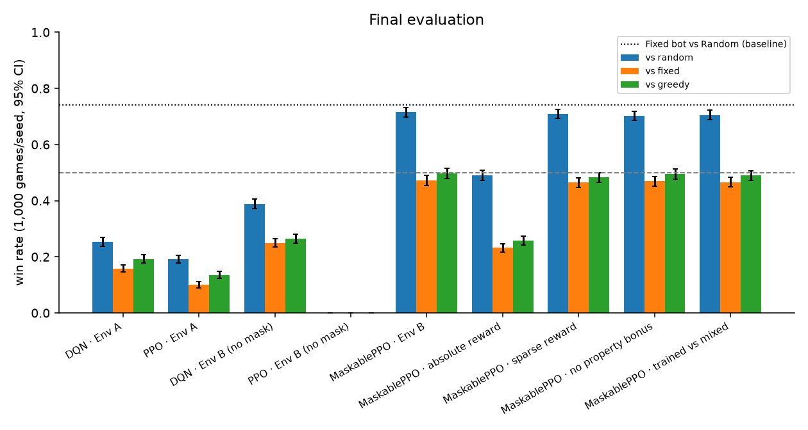
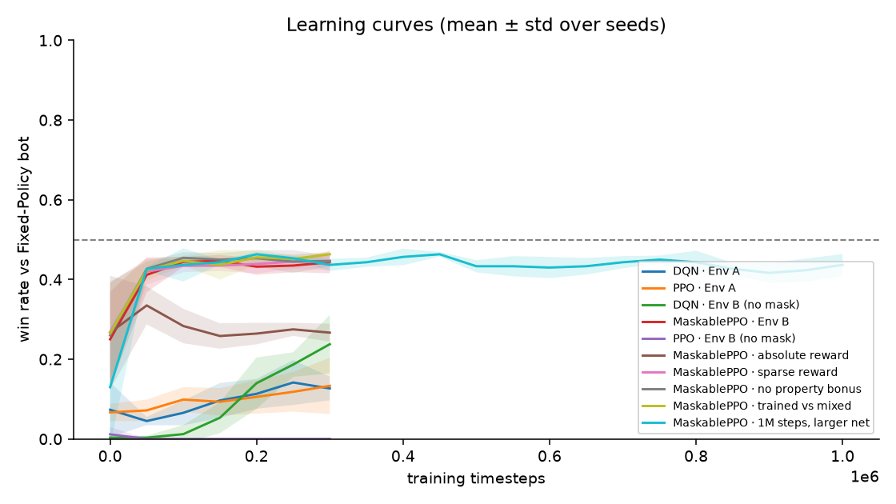

# India Property Game · Explainable RL Agents

> *Working title: the final game name is still to be decided.*

An **original, Indian-themed, 2-player property-trading board game** that follows Monopoly's rules, played on 40 spaces of Indian cities and railway stations. Reinforcement-learning agents learn to play it. A **web game UI** lets you watch the AI play, play against it yourself, and look inside its "brain" at every decision.

Built for our AI course by a team of 4.

| | |
|---|---|
| 🎲 **Game engine** | Pure-Python, deterministic, tested: rent tables, houses/hotels, stations, utilities, jail, original card decks, forced liquidation, bankruptcy |
| 🤖 **Agents** | DQN, PPO and MaskablePPO (Stable-Baselines3) vs Random, Fixed-Policy (Bailis et al. 2014) and Greedy bots |
| 🧪 **Experiments** | 10 configurations × 3 seeds × 1,000 evaluation games: env design, action masking, reward shaping, property bonus, training opponent, training length |
| 🧠 **AI Brain X-Ray** | Live action probabilities / Q-values, legal-action mask, critic value and reward signal for every agent decision |
| 🖥 **Web UI** | FastAPI + React: animated board, Watch AI vs Bot, Play vs AI, Results dashboard, How-it-works page |

---

## Quick start

```bash
# 1. Python backend (3.11+)
python3 -m venv .venv && source .venv/bin/activate
pip install -r requirements.txt            # CPU torch is fine; see "GPU" below
uvicorn src.api.main:app --port 8000

# 2. Frontend (Node 20+), in a second terminal
cd frontend && npm install && npm run dev  # open http://localhost:5173
```

Trained models are committed in `models/`, so the demo works without training.

## Results

All numbers below are generated by `python -m src.rl.make_plots` into [`results/summary/summary.json`](results/summary/summary.json). Win rates are pooled over 3 seeds × 1,000 games against each opponent. The starting player is random in every game.

| Config | Algorithm | Env | Reward | vs Random | vs Fixed | vs Greedy |
|---|---|---|---|---|---|---|
| E1 | DQN | A (blueprint) | Δ share | 25.3% | 15.8% | 19.3% |
| E1 | PPO | A (blueprint) | Δ share | 19.1% | 10.0% | 13.5% |
| E2 | DQN | B, no mask | Δ share | 38.8% | 25.0% | 26.5% |
| E2 | PPO | B, no mask | Δ share | 0.0% | 0.0% | 0.0% |
| **E2** | **MaskablePPO** | **B, masked** | **Δ share** | **71.5%** | **47.2%** | **49.7%** |
| E3 | MaskablePPO | B, masked | absolute share | 49.0% | 23.2% | 25.8% |
| E3 | MaskablePPO | B, masked | sparse (win/loss) | 70.9% | 46.4% | 48.2% |
| E4 | MaskablePPO | B, masked | Δ share, no property bonus | 70.3% | 46.9% | 49.5% |
| E5 | MaskablePPO | B, masked | Δ share, trained vs mixed bots | 70.6% | 46.6% | 48.9% |
| E6 | MaskablePPO | B, masked | Δ share, 1M steps, larger net | 71.7% | 46.6% | 49.7% |

Rule-bot baselines (1,000 games): Fixed vs Random **74.1%**, Greedy vs Random **72.7%**, Greedy vs Fixed **46.7%**, Random vs Random 49.0%.




### What we learned
1. **Environment design and action masking matter most.**
   - The blueprint setup (Env A: asked after every move, 32 inputs) reaches only 10–16% against the Fixed bot, and 60–69% of its actions do nothing.
   - Asking only at real decision points and masking illegal actions (Env B + MaskablePPO) triples that, to 47%.
2. **Without masking, PPO can collapse.** On Env B, 90% of unmasked PPO's choices were invalid. It learned to never buy anything and lost every game.
3. **The blueprint's reward hurts, as we predicted.** Paying the *absolute* net-worth share at every step rewards long games: 139 rounds on average, against 109 with the Δ-share reward. Its win rate against Fixed halves, to 23%.
4. **Sparse reward, the property bonus and the training opponent made little difference** at this scale (all within about 1 point of each other).
5. **The agent plateaus at the Greedy bot's level.**
   - The best agent buys 84–96% of the properties it is offered in every colour group, so it has learned a near-greedy strategy.
   - That strategy gets the same ~47% against the Fixed bot as the Greedy bot itself.
   - Training 3× longer with a bigger network (E6) didn't change it.
   - Our reading: with no trading or auctions in a 2-player game, there is little room to out-play a sensible threshold rule. That fits Bonjour, Haliem et al.'s finding that much of the strategy lives in the actions this scope removes.

## How it works

```
frontend (React + TS)  ──HTTP──▶  src/api (FastAPI sessions, X-Ray)
                                     │
             src/envs (Gymnasium) ◀──┼──▶ src/rl (train / evaluate / make_plots)
                                     │
                         src/engine (pure-Python rules)  ◀── src/bots
```

- **Engine:** a generator-driven state machine. `Game.advance()` runs until someone must decide; `Game.act(a)` answers. Bots, RL environments, the API and human players all drive the same engine.
- **Env A (blueprint):** 32 inputs; Discrete(3) Pass/Buy/Build asked after every move; invalid choices act as Pass.
- **Env B (ours):** 133 inputs; Discrete(10) Pass/Buy/Build-on-group, asked only at real decision points, with `action_masks()` for MaskablePPO.
- **Reward:** weighted net worth from Bonjour, Haliem et al. (2022), Eq. 2–3 (properties ×1.5, or ×2 in a completed set).
  - `share = nw_agent / (nw_agent + nw_opponent)`.
  - Default per-step reward = Δshare, plus ±10 at the end of the game.
- **Rules:** ₹1,500 start, ₹200 for passing GO, classic rent tables in ₹, jail (3 tries / ₹50), two original 16-card decks, no trading or auctions, game ends at bankruptcy or after 200 rounds.

The full design is in [`docs/TECH_SPEC.md`](docs/TECH_SPEC.md), and the requirements are in [`docs/PRD.md`](docs/PRD.md).

## Reproducing everything

```bash
pytest -q                                    # 42 tests: rules, invariants, envs, API
scripts/run_experiments.sh 3                 # all configs x 3 seeds (≤3 parallel jobs)
python -m src.rl.train --config experiments/e2_maskppo_b.yaml --seeds 0
python -m src.rl.evaluate --model models/e2_maskppo_b_s1 --games 1000
python -m src.rl.make_plots                  # results/summary/summary.json + figures
```

**GPU:** `train.py --device auto|cuda|cpu` (default `auto`). To use CUDA, install it with `pip install --index-url https://download.pytorch.org/whl/cu128 torch`. On our RTX 4050 laptop the GPU gave **no speedup** for our [256, 256] network, because the game simulation on the CPU is the bottleneck. It was **2.1× faster** for a [1024, 1024] network.

## Repository layout

| Path | Contents |
|---|---|
| `src/engine` | board data, rules, cards, engine state machine (no ML imports) |
| `src/bots` | Random, Fixed-Policy, Greedy bots + shared jail rule |
| `src/envs` | Gymnasium Env A / Env B, observation encoders, rewards |
| `src/rl` | training, evaluation, X-Ray, aggregation and plots |
| `src/api` | FastAPI app and game sessions |
| `frontend` | React game UI |
| `experiments` | one YAML per experiment configuration |
| `models`, `results` | trained agents, evaluation JSON, summary and figures |
| `presentation` | web slide deck |
| `docs` | PRD, technical spec, phases, reflections on the original blueprint, memory docs |

## References
1. P. Bailis, A. Fachantidis, I. Vlahavas. *Learning to play Monopoly: A Reinforcement Learning approach.* AISB 50, 2014.
2. E. Arun, H. Rajesh, D. Chakrabarti, H. Cherala, K. George. *Monopoly using reinforcement learning.* TENCON 2019, pp. 858–862.
3. T. Bonjour, M. Haliem, A. Alsalem, S. Thomas, H. Li, V. Aggarwal, M. Kejriwal, B. Bhargava. *Decision Making in Monopoly using a Hybrid Deep Reinforcement Learning Approach.* IEEE TETCI, 2022. arXiv:2103.00683.
4. J. Schulman et al. *Proximal Policy Optimization Algorithms.* arXiv:1707.06347, 2017.
5. V. Mnih et al. *Human-level control through deep reinforcement learning.* Nature 518, 2015.
6. S. Huang, S. Ontañón. *A Closer Look at Invalid Action Masking in Policy Gradient Algorithms.* FLAIRS 2022.
7. A. Raffin et al. *Stable-Baselines3: Reliable Reinforcement Learning Implementations.* JMLR 22, 2021.

## Note on intellectual property
This is an original game made for teaching and research. It follows the publicly known *rules* of Monopoly but uses no Hasbro or Funskool names, logos, artwork or card text. Space names are real Indian places, and prices and rents use the classic structure in rupees.

## Team
Team member names and roles: *to be added* (see `docs/memory/OPEN_QUESTIONS.md` Q3).
